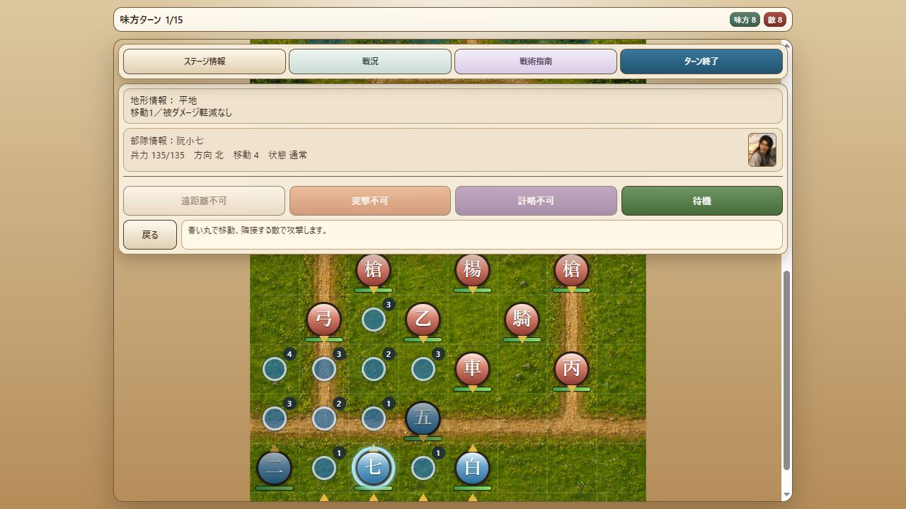

# Milestone 29 — 第三章の連続脱出と移動終点での勝利判定

2026-10-10。版は `10.0.0-dev.29`。第三章を初期配置から脱出勝利まで通す経路を追加し、V9と異なっていた確定移動中の勝利判定を修正した。人物値、地形、敵編成、AI、乱数規則、保存形式6、内容revisionは変更していない。

## 第三章の連続攻略検証

`test-support/convoy-escape-route.js` に、元のV9データとseed 1による12ターンの操作経路を保存した。部隊位置・兵力・状態・イベント完了を直接書き換えず、移動、通常攻撃、幻術、撹乱、待機、敵ターンを通常のcontrollerコマンドで進める。

- 第5自軍ターン中に最後の護送兵を倒し、その場で任務更新と追捕軍15隊の出現会話が発生する。
- 北へ先行する晁蓋を、阮小五、公孫勝らの攻撃・計略で支援する。水兵を倒して湿地の退路を確保する。
- 第12ターン、晁蓋が `(3,0)` に到達して `birthday-convoy_escape` で勝利。晁蓋の兵力19、敵13隊が残る。全員生存や全乱数での安定攻略を示す経路ではない。
- M27の第4ターン護送隊壊滅経路も別に維持し、早期壊滅と第5ターン中壊滅の両方を検証する。

`tests/v9-battle-progression.test.js` では、連続実行と次の2か所からの保存再開を比較した。

1. 第5ターン開始時：最後の護送兵が兵力12で生存し、任務更新・増援とも未発生。
2. 第6ターン開始時：任務更新・増援が完了し、追捕軍15隊が生存。

いずれも正規SaveService・slot guard・`resumeLoadedBattle` を使用。再開後の最終状態は、部隊・イベント・戦況履歴・乱数状態を含めて連続実行と完全一致する。導入会話と作戦条件を再生せず、増援会話は未発生の場合だけ1回提示する。勝利結果と章末会話の順序、結果ログ1回、runtime整合性も確認した。

`tests/battle-screen.test.js` には同じ経路を盤面・コマンドのclickイベントから通す結合テストを追加した。移動しない攻撃、移動プレビューの非変更性、幻術の直接対象選択、撹乱レベル選択、待機・計略後の向き指定、導入・増援・章末会話を確認する。fake DOM上の結合テストであり、実ブラウザーでの第三章完走ではない。

## 脱出判定の修正

V10は確定移動の一歩ごとに勝利を判定していた。そのため、脱出範囲を通り抜けて範囲外へ移動する操作でも途中で勝利し、範囲内の奥を指定した場合も入口で移動が止まっていた。

固定V9の `game.js` の `moveSelected` は `animateUnitPath` の終了後に `checkResult()` を呼ぶ。これに合わせ、`BattleController` では経路の終点、罠による中断、行動継続不能による停止時だけ移動中の勝利判定を行うようにした。一歩ごとの向き・罠・到達イベントと敗北優先の処理は維持する。

回帰テスト3件を追加した。

- 脱出マスを通過して範囲外に止まると戦闘を継続する。
- 半径1の脱出範囲に入った後も、指定した終点まで移動してから勝利する。
- 罠で脱出範囲内に止まった場合は、その停止位置で勝利する。

最初の2件は修正前に失敗し、修正後に成功。M28の移動方向保持テストも引き続き成功した。

## 実ブラウザーと全体検証

- 全294テスト成功（追加5件、失敗・スキップ0）。
- `node --check` でcontrollerと起動入口2ファイルを確認。`git diff --check` 成功。
- 比較用Nodeサーバーを4174で再起動。dev.29で前回の第三章第1ターンの中断データを通常の再開ボタンから読み込んだ。
- 阮小七 `(2,14)` → `(2,12)` の仮移動と「戻る」での取消を実画面で確認。取消後は `(2,14)`、北向き、兵力135、未行動のまま。ブラウザー警告・エラー0件。
- 実画面での確認範囲は起動・再開・仮移動・取消。今回の第12ターン勝利は上記の自動検証による。
- V9参照HEAD `3e3fb85ca8279e5351668562dea677df777a1ddc`、作業ツリー未変更。
- 探索用スクリプトは削除し、成功した経路と検証だけを残した。変更はローカル保存済み、push・公開はしていない。

## 次に進める範囲

- 実ブラウザーでの第二・三章の勝利確認とV9との操作比較。
- 脱出マスを選んだ直後の画面遷移タイミング。V10は移動プレビューから待機・攻撃を確定した時にDomain移動を実行するため、V9の移動直後判定とまだ差がある。
- 第四章以降の勝利経路、章固有演出、表示・操作の差分。

全章の手動完走・V9との完全一致は未確認。ユーザー本人のプレイテストを進行の前提にしない。
