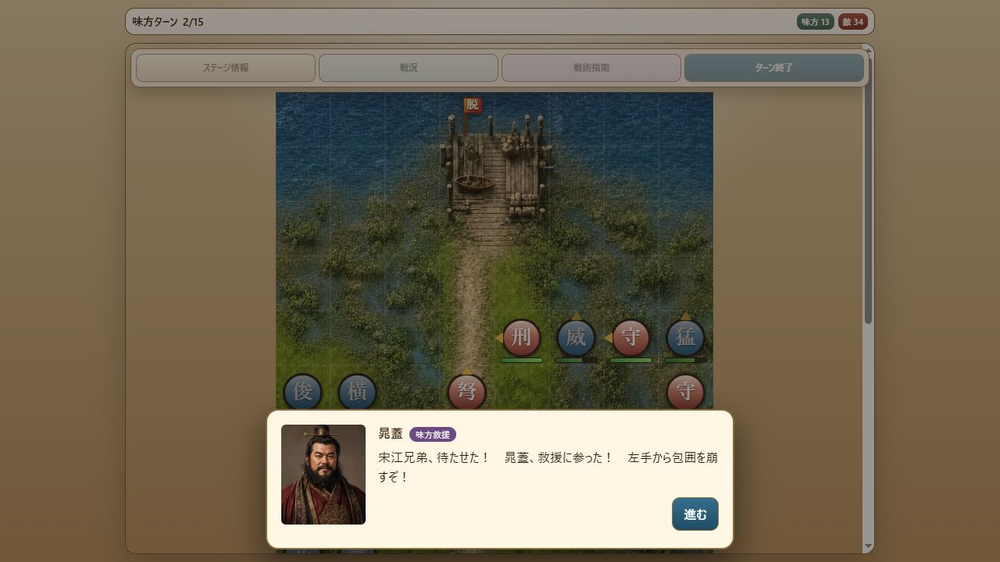

# Milestone 32 — 第五章の連続攻略と救援会話の表示復元

2026-10-10。版は `10.0.0-dev.32`。第五章を初期配置から二人の脱出まで通常コマンドで検証し、実ブラウザーで見つかった救援会話の表示漏れを修正した。人物値・編成・地形・戦闘ルール・乱数規則は変更していない。保存形式6、内容revision `v10-v9-chapter-catalog-9` を維持。

## 実装した修正

- `Speech.actionLabel` に存在していた「味方救援」「敵軍警戒」が、会話画面へ渡されていなかった。BattleViewの要素定義とBattleRendererを接続し、人物名の横へV9と同じ紫色のラベルを表示する。
- ラベルのない次の台詞では文字を消して非表示にし、会話終了時にもクリアする。戦法カットインと通常会話の役割は維持。
- 固定V9は会話の最終行でもボタンを「進む」と表示する。V10の「閉じる」への切替を廃止し、不要になった最終行判定をScreenから取り除いた。
- V9参照の会話コードとHTML、第五章の導入6台詞・作戦条件を実ブラウザーでも確認した。全画面の完全一致を確認したという意味ではない。

## 第五章の連続攻略

`test-support/jiangzhou-escape-route.js` に、元の編成・能力値とseed 1の第7ターン脱出経路を保存した。途中の兵力・配置変更、敵の強制除去、能力値の上書きはない。

1. 第1ターンに宋江が西へ退避。李逵・戴宗と水軍が各方面の敵に対処。
2. 第2味方ターンの開始時に、晁蓋ら7人が本来の位置へ出現し、当該ターンから行動。
3. 救援隊が弩兵などを排除し、宋江と晁蓋が北へ進む。
4. 第5ターンに晁蓋が `(3,1)` へ先着。宋江は `(3,5)` にいるため戦闘は継続。
5. 晁蓋は第6ターンに `(4,0)` へ移動。第7ターンに宋江が `(3,0)` を選んで脱出勝利。

最終状態は宋江10、晁蓋146、敵28隊生存。味方9隊が敗走する経路であり、全員生還や全乱数での攻略、バランス調整済みを意味しない。

## 保存・画面入力の回帰検証

`tests/v9-battle-progression.test.js` で、連続実行と次の4地点からの再開を比較した。

- 第1ターンの全味方行動後、敵ターンへ進む直前。救援は未発生。
- 第2ターン開始、救援7人の登場直後。
- 第5ターン途中、晁蓋だけが脱出範囲に先着し、宋江・晁蓋がともに行動済みの状態。
- 第7ターン開始、宋江の最後の移動直前。

通常のSaveService・slot guard・resumeLoadedBattleを使用。部隊・位置・向き・状態・使用回数・乱数・イベント・戦況履歴を含む最終データが完全一致。救援の重複加入なし、救援会話の不要な再表示なし、勝利結果・章末会話・中断保存の消去も確認。

`tests/battle-screen.test.js` では全経路を盤面・戦法・弓撃・待機・向き指定のクリックイベントで実行した。救援会話中の盤面・ターン終了入力が進行に影響しないこと、一人目の脱出プレビューは取消可能なこと、最後の宋江の移動だけで勝利することを確認。会話ラベルの切替と「進む」の表示も確認した。これはfake DOMでの結合テストであり、第五章の実ブラウザー完走とは区別する。

## 実ブラウザー確認

V10の通常の章選択から第五章を開始し、第1ターンを盤面とコマンドボタンだけで操作。第2ターンの救援会話へ到達した。乱数seedや保存内容の注入はしていない。

表示修正後にページを再読み込み。「第五章・第1ターン・敵ターン」の中断データから再開し、救援会話へ正常に進んだ。「味方救援」→「敵軍警戒」→ラベルなしの台詞という切替と、全6台詞を「進む」で終えることを確認。

終了時はdev.32、第五章の第2味方ターン。味方13隊・敵34隊、宋江60・戴宗55。救援7人はそれぞれ所定位置におり、全員行動可能。ブラウザーの警告・エラーは0件。この実乱数の試行は自動検証のseed 1とは兵力・敗走者が異なる。

## 確認結果と残作業

- 全304テスト成功（失敗・スキップなし）。実表示修正後に全体を再実行。
- 起動入口・変更したRenderer/Screen・追加経路の構文確認、およびdiffの空白チェック成功。
- 固定V9参照HEAD `3e3fb85ca8279e5351668562dea677df777a1ddc` は未変更。
- 探索用スクリプトは削除し、通常コマンドによる経路と回帰テストを残した。変更はローカル保存のみ。
- 連続攻略の自動検証は第一〜五章まで。第六〜九章の連続攻略・保存再開と、第二〜五章の実ブラウザー完走・操作比較は残る。
- ユーザー本人のプレイテストを作業の前提にしない。

