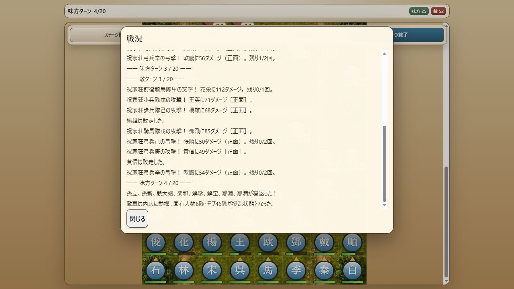

# Milestone 34 — 第六章の勝利経路と寝返り時の戦況履歴

2026-10-14。版は `10.0.0-dev.34`。第六章を初期配置から第18ターンの殲滅勝利まで通常コマンドで検証し、寝返り時に敵軍へ付与される撹乱の履歴漏れを修正した。人物値・編成・敵AI・戦闘ルール・乱数規則は変更していない。保存形式6、内容revision `v10-v9-chapter-catalog-9` を維持。

## 実装した修正

固定V9の `activateZhujiaBetrayal` は、孫立らの寝返りと祝家荘軍への撹乱をそれぞれ戦況履歴へ記録していた。V10は所属変更と撹乱そのものは実行していたが、後者の説明が履歴から抜けていた。修正前は履歴件数0、修正後は1となる回帰テストで確認。

`BattleLogRecorder` が確定済みの寝返りイベントを読み、対象軍の生存・配置済み部隊を固有人物とモブに分けて記録する。寝返った味方、敗走部隊、予備部隊を件数に含めない。保存・再開で重複しない。状態異常の計算・継続ターンには触れず、混乱効果を伴わない第九章の寝返りでは追加表示しない。

## 第六章の勝利経路

`test-support/manor-victory-route.js` に、元の80部隊・人物能力と乱数seed 1による18ターン・308操作の経路を保存。探索用の選択ロジックは製品に入れず、検証では記録した移動先・対象・待機方向だけを通常のControllerコマンドへ渡す。

- 第1〜3ターンに南側の敵へ対処。宋江を守りながら、突撃・弓撃・撹乱を使用する。
- 第4味方ターンに孫立ら8人が加入。この時点で生存敵44隊に撹乱が付き、味方28人が所属する。
- 前後の部隊で残敵を倒し、第18ターンに殲滅勝利。結果IDは `zhu-family-manor_annihilation`。
- 最終状態は宋江71、味方7隊生存、敵0隊。21隊の敗走を伴う経路であり、全員生還・全乱数での攻略・バランス調整済みを意味しない。
- 罠4個は未発動のまま。罠の効果と回避はM33の別経路テストで引き続き検証する。

部隊の強制配置・兵力上書き・敵の強制除去・ターンやイベントの直接変更はない。経路の探索・再生はNodeによる自動検証であり、実ブラウザーの勝利完走とは区別する。

## 保存再開と画面入力

`tests/v9-manor-progression.test.js` で、連続実行と次の4地点からの再開を比較した。

1. 第3味方ターンの全行動後、寝返り前の敵ターンへ進む直前。
2. 第4味方ターンの寝返り・会話・フェーズ開始処理の完了直後。
3. 第5味方ターンの開始時。寝返り後の敵ターンを一度通過した状態。
4. 第18味方ターンの最後の攻撃直前。敵が1隊だけ残る状態。

通常のSaveService・slot guard・resumeLoadedBattleを使用し、部隊・位置・向き・状態・使用回数・罠・乱数・イベント・戦況履歴を含む最終データが完全一致した。寝返りの重複加入や会話の再表示はなく、勝利結果・章末会話・中断保存の消去まで確認。

`tests/battle-screen.test.js` では同じ全308操作を、部隊選択・移動・攻撃・戦法・撹乱レベル選択・待機・方向指定のクリック入力で実行した。寝返り会話中の盤面・ターン終了入力を拒否し、加入人物がそのターンから行動できること、勝利から章末会話まで進むことを確認。fake DOMを使用する結合テストであり、実ブラウザーの完走ではない。

## 実ブラウザー確認

dev.34でM33の第六章中断データを再開し、全味方の待機とターン終了を通常の盤面操作で進めた。第4味方ターンに呉用・孫立・祝朝奉の3台詞を表示し、孫立ら8人が元の位置で北向き・行動可能になることを確認。敵52隊すべてに撹乱1を表示し、戦況には「固有人物6隊・モブ46隊が撹乱状態となった」と一度だけ記録された。

ページを再読み込みし、中断データから再開。第4味方ターン・味方25隊・敵52隊、敵全隊の撹乱1、履歴が保持された。寝返り会話の再表示や二重加入はない。孫立を選ぶと兵力142/142、北向き、弓撃2/2・突撃3/3・撹乱5/5が表示され、通常操作へ戻れた。

終了時は第4味方ターン、宋江149。張横・楊雄・黄信が敗走済みで、孫立らは全員生存・未行動。孫立を選択した状態を残し、中断保存も保持。警告・エラー0件。ブラウザーではseed・保存内容・盤面の注入を行っていない。この実乱数の試行は勝利経路の自動検証とは別で、実ブラウザーの勝利完走は未達。

## 検証結果

- 全312テスト成功、失敗・スキップなし。
- 起動入口、戦況記録、追加経路の構文確認とdiffの空白チェック成功。
- 固定V9参照HEAD `3e3fb85ca8279e5351668562dea677df777a1ddc` と作業ツリーは未変更。
- 探索用スクリプトと一時経路JSONは削除し、再現経路と回帰テストだけを保存した。
- 第一〜六章の勝利経路を自動検証済み。第七〜九章の勝利経路、第二〜六章の実ブラウザー完走・操作比較は残る。
- M14以降の変更を保持し、ローカルに保存。push・公開なし。ユーザー本人のプレイテストを前提にしない。
