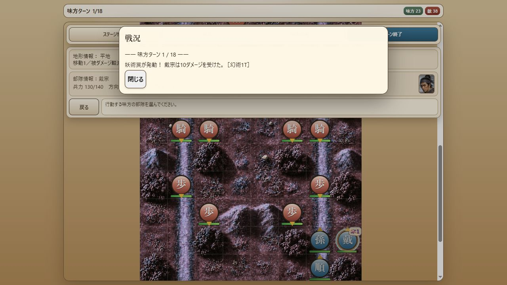

# Milestone 35 — 第七章の連続攻略と同士討ち後の保存修正

2026-10-14。版は `10.0.0-dev.35`。第七章を初期配置から第18ターンの殲滅勝利まで検証し、同士討ちによる敗走後に保存できなくなる不具合を修正した。人物能力・編成・敵AI・乱数・ダメージ・状態異常の規則は変更していない。保存形式6、内容revision `v10-v9-chapter-catalog-9` を維持。

## 敗走と保存の不具合

第13味方ターン開始時、幻術にかかった呂方が公孫勝を倒す通常進行で発見。Controllerは敗走者をマップから取り除いていたが、その人物が同じ軍の未行動部隊の場合、`READY` が残っていた。`isStableForSave()` が偽となり、手動保存と中断保存ができない状態になっていた。

`BattleController` の行動結果処理で、敗走した部隊の行動を `FINISHED` にしてから位置を除去する。罠による敗走も同じ順番にそろえた。勝敗判定・イベント・演出より前に整合した状態にする。状態遷移と盤面管理はそれぞれUnit・BattleMap、処理順はControllerが担当する。

修正前に第七章の実進行と小規模な同士討ちテストの双方で失敗を再現。修正後は幻術・火計・水計の味方への致死ダメージでも、兵力0・位置なし・行動終了を中断保存へ記録できることを確認した。敗走履歴は一度だけ記録する。

## 第七章の勝利経路

`test-support/sorcery-victory-route.js` に元の61部隊（味方23・敵38）、seed 1による18ターン・226操作を記録した。通常の移動・攻撃・突撃・弓撃・撹乱・幻術・待機をControllerへ渡す。部隊の強制配置、兵力上書き、敵の強制除去、ターン・イベント状態の直接変更はない。

- 第6味方ターン開始時、幻術の強制行動で孫立が `(3,11)` の通常罠へ進み、20ダメージで敗走。反応台詞を表示して進行する。
- 第13味方ターン開始時、同士討ちで公孫勝が敗走しても戦闘を継続する。
- 高廉の広域幻術は第13・15・16敵ターンで発動する。
- 第17味方ターンに高廉が敗走。残敵がいるので勝利にはしない。
- 第18ターンに最後の飛天弩兵を倒して殲滅勝利。宋江149、味方5隊生存、敵0隊。柴進を含む章末会話まで到達。

18隊の敗走を伴う検証経路であり、全員生還や全乱数での攻略を示すものではない。妖術罠2個と通常罠1個は未発動のまま。探索用の判断ロジックは製品へ組み込まず、再現経路だけを残した。

## 保存再開と画面入力

`tests/v9-sorcery-progression.test.js` で、通常のSaveService・slot guard・resumeLoadedBattleを使い、次の5地点からの最終データを連続実行と比較した。

1. 第9味方ターン開始、幻術の残存中。
2. 第13味方ターン開始、公孫勝の敗走直後。
3. 第14味方ターン開始、高廉の最初の広域幻術の後。
4. 第17味方ターンの2操作後、高廉の敗走後・残敵あり。
5. 第18味方ターン開始、最後の攻撃直前。

部隊・位置・向き・使用回数・状態異常・罠・乱数・イベント・戦況履歴を含む最終データが一致。開始会話と作戦条件の再表示はなく、結果と章末会話は一度だけ表示した。

別の元編成経路では、石秀・李逵・孫立・張順を通常の移動待機で進め、公孫勝を前進させた後、戴宗を `(7,14)` の妖術罠へ進めた。10ダメージ・幻術1・停止・行動終了・初回警告を確認。前進後、罠直後、第2味方ターン開始の3地点から再開しても同じ最終データとなり、警告は再表示しない。公孫勝の妖術罠無効化は既存の専用テストと履歴テストで確認しており、この別経路では扱っていない。

`tests/battle-screen.test.js` では226操作すべてを盤面・コマンドのクリック入力で実行。公孫勝の幻術は直接対象選択へ進み、通常の撹乱ではレベルを選ぶ。第6ターンの致死罠台詞中は入力を受け付けず、閉じた後は操作と保存が可能。章末会話まで成功した。これはfake DOMによる結合テストで、実ブラウザー完走とは区別する。

## 表示の修正

- V9の罠履歴にあった「妖術罠」の種別と、無効化後に罠が消滅する説明を復元。通常罠・妖術罠・無効化・致死ダメージを確認し、ルールの再計算はしない。
- 実ブラウザーで第七章の作戦条件に `<b>` が文字として出る不具合を発見。固定V9の説明文を文字表示へ変換する関数を作戦条件とステージ情報で共用し、改行と特殊ルールの本文を保持した。

## 実ブラウザー確認

dev.35の第七章を新規に開始し、導入5台詞と作戦条件を確認。孫立を `(6,15)`、張順を `(6,16)` へ移動して北向きで待機させ、戴宗の目的地に `(7,14)` を選択した。その選択だけで罠の移動が確定し、戴宗は `(7,15)` で停止。兵力140→130・幻術1・行動終了となった。

戴宗の「妖術罠」反応台詞、高廉の台詞、公孫勝の警告を順に表示。戦況に「妖術罠が発動！ 戴宗は10ダメージを受けた。［幻術1T］」を一度記録した。作戦条件とステージ情報の双方で装飾タグが出ないことも確認。

ブラウザーにはseedや盤面を注入していない。この実乱数の罠位置は、自動検証のseed 1とは異なる。第七章の実ブラウザー勝利完走は未実施。

ページ再読み込み後に「続きから再開」を選び、第1味方ターン・味方23隊・敵38隊へ復帰。戴宗 `(7,15)`・130/140・北向き・幻術1・行動終了、孫立 `(6,15)` と張順 `(6,16)` の待機状態を保持。導入・作戦条件・罠会話の再表示はなく、罠の履歴も一件のまま。警告・エラー0件。終了時は戴宗の情報を表示し、中断保存を保持している。

## 検証と残作業

- 全317テスト成功、失敗・スキップなし（28.5秒）。
- 起動入口・Controller・説明文変換・攻略経路の構文確認、diff空白チェック成功。
- 固定V9参照HEAD `3e3fb85ca8279e5351668562dea677df777a1ddc` と作業ツリーは未変更。
- 第一〜七章の勝利経路を自動検証済み。第八・九章の連続攻略と保存再開、第二〜七章の実ブラウザー完走・比較は残る。
- M14以降の作業を保持し、ローカルに保存。push・公開なし。ユーザーのプレイテストを作業の前提にしない。
