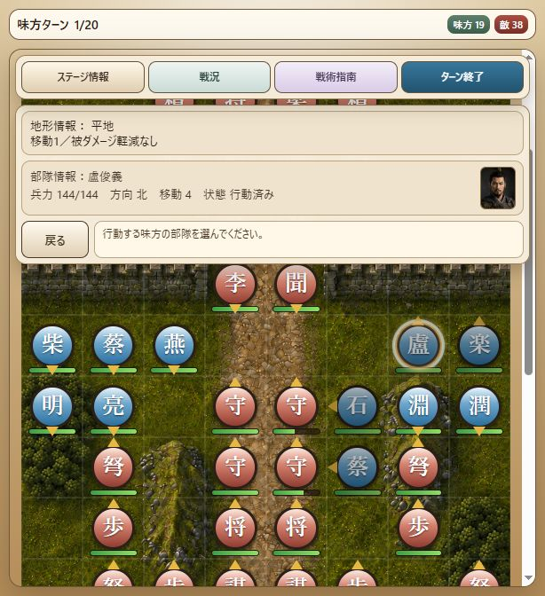

# Milestone 36 — 第八章の両名脱出・保存再開・V9操作比較

2026-10-16。版は `10.0.0-dev.36`。第八章「大名府・獄門脱出」を元の編成から第6ターンの脱出勝利まで検証した。人物能力、初期位置、兵力、敵AI、乱数、移動・攻撃・状態異常・勝敗の規則は変更していない。保存形式6、内容revision `v10-v9-chapter-catalog-9` を維持。

## 元編成の勝利経路

`test-support/daming-escape-route.js` に、味方19・敵38の計57部隊、seed 1による6ターン・84操作を記録した。通常の移動・攻撃・突撃・弓撃・撹乱・待機をControllerへ渡す。部隊の強制配置、兵力上書き、敵の強制除去、ターン変更は行っていない。

第1ターンに燕青が李成へ撹乱を使い、蔡慶と楽和が通路を空け、石秀と盧俊義を東側へ移す。救援隊が川の封鎖部隊を攻め、城門からの追撃を受けながら南へ移動する。第5ターンに両名が川を越え、第6ターンに盧俊義が `(3,14)` で先着。勝利せず、石秀の `(4,15)` 選択で移動を確定し、両名脱出の勝利になる。

- 盧俊義95・石秀97・呉用145。
- 味方14隊生存、敵20隊生存。
- 5隊の味方敗走を伴う検証経路。全員生還や全乱数での攻略を示すものではない。
- 敵AIの城門前詰め、移動後は通常攻撃のみ、前進不能時の計略・弓撃という処理を固定V9コードと照合。攻略用の判断ロジックは製品へ組み込まない。

## 保存再開と画面入力

`tests/v9-daming-progression.test.js` は通常のSaveService・slot guard・resumeLoadedBattleを使用し、以下の4地点からの最終データが連続実行と完全一致することを確認する。

1. 第1ターンの8操作後：両名を城門正面から移した状態。
2. 第3味方ターン開始：追撃を受け、状態異常がある状態。
3. 第5ターンの2操作後：両名が川の南へ移った状態。
4. 第6ターンの1操作後：盧俊義だけが脱出範囲内、石秀は未到着・未行動。

比較対象は兵力・位置・向き・行動状態・使用回数・状態異常・乱数・イベント・戦況履歴を含む。ロード時は導入・作戦条件を再生せず、結果と章末会話は一度だけ表示する。

`tests/battle-screen.test.js` は84操作を盤面・コマンドのクリック入力で実行する。盧俊義の先着は取り消せる仮移動で、戻る操作が位置と乱数を変えないことも確認。石秀の最後の目的地クリックでは待機・向き指定を挟まず勝利し、章末会話を表示する。fake DOMの結合テストであり、実ブラウザー完走とは区別する。

## 脱出範囲の画面指定

実ブラウザーのDOM比較で、V9は南の4マス `(3,14), (2,15), (3,15), (4,15)` に `escape-zone` を付けているが、V10は旗の中心 `(3,15)` のみだった。Rendererが半径を参照していなかったため修正し、旗は中心1本のままとした。目標未有効時に旗だけを残す挙動も維持する。

V9の `.escape-zone` は `box-shadow:none` で、範囲を着色する仕様ではない。今回も新しい色・輪郭・表示要素は追加していない。勝利判定は修正前から周囲のマスを含んで正しく動作しており、変更は画面側のマス指定のみ。修正前の結合テスト失敗（中心1マス）、修正後の4マス一致を確認した。

## 実ブラウザーでの比較

V9.7.75とV10の両方で第八章を新規開始。導入8台詞、勝利・敗北条件、味方19・敵38の初期配置を比較した。V10は更新後に再読み込みしてdev.36を使用。

両版で蔡慶を `(5,4)` から `(5,6)` へ移し、大名府守備兵丁を通常攻撃。V10では仮移動を一度取り消し、元の位置へ戻ることを確認してから再実行した。この試行では両版とも84ダメージ［側面］だったが、乱数は注入・同期していない。

続いて両版で石秀を `(5,5)` へ移して獄門守備兵乙を攻撃。楽和を `(7,4)` へ移して北向き待機、盧俊義を `(6,4)` へ移して北向き待機。移動先の情報・向き・行動済み表示を比較した。第1ターン中までの実操作比較であり、敵ターンを含む完走ではない。

V10を再読み込みし「続きから再開」で、第1味方ターン・味方19・敵38に復帰。蔡慶 `(5,6)`・131、石秀 `(5,5)`・139、楽和 `(7,4)`・117、盧俊義 `(6,4)`・144の行動済み状態を保持した。盧俊義は北向き。導入・作戦条件の再表示なし。両版のコンソール警告・エラー0件。終了時は盧俊義の情報を表示し、中断保存を保持。比較用V9タブは閉じた。

## 検証と残作業

- 全319テスト成功、失敗・スキップなし（37.1秒）。
- 起動入口・Renderer・攻略経路の構文確認とdiff空白チェック成功。探索用スクリプトと一時経路は削除済み。
- 第一〜八章の元編成からの勝利・保存再開・画面入力を自動検証済み。
- 第九章の元編成からの勝利経路と保存再開、第二〜八章の実ブラウザー完走・細かなV9比較が残る。
- 固定V9参照HEAD `3e3fb85ca8279e5351668562dea677df777a1ddc` と作業ツリーは未変更。
- M14以降の作業を保持し、ローカルに保存。push・公開なし。ユーザーのプレイテストを前提にしない。
