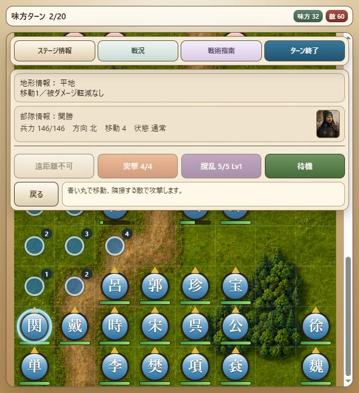

# Milestone 37 — 第九章の寝返り・救援・保存再開

2026-10-17。版は `10.0.0-dev.37`。第九章「曾頭市・宿命の決戦」の通常進行から寝返り・救援と保存再開を検証した。第九章の勝利経路は未確認。人物能力、兵力、配置、敵AI、乱数や戦闘規則は変更していない。保存形式6、内容revision `v10-v9-chapter-catalog-9` を維持。

## 元の編成からのイベント進行

`test-support/zengtou-event-route.js` は、元の95部隊（味方31・敵60・予備4）、seed 1による6味方ターン・137操作。通常の移動・攻撃・突撃・弓撃・撹乱・幻術・待機をControllerへ渡し、兵力・位置・ターン・イベントの直接変更や敵の強制除去をしない。

第5敵ターンに秦明が敗走し、第6味方ターン開始時に郁保四の寝返り、関勝・徐寧・単廷珪・魏定国の救援が続けて発生する。郁保四は兵力130・南向き・位置 `(3,10)` を保ち、救援4隊は所定の南端の位置へ全兵力で現れる。同じターンに5人全員へ指示し、行動を終えられることを確認した。この経路は第6味方ターン終了前で止めている。勝利を示す経路ではない。

`tests/v9-zengtou-progression.test.js` は通常のSaveService、slot guard、resumeLoadedBattleを使い、以下の4地点からの最終状態が連続実行と完全一致することを確認する。

1. 第5味方ターンの全操作後、秦明がまだ生存している状態。
2. 第6味方ターン開始、寝返りと救援の直後。
3. 第6味方ターンの5操作後、郁保四が加入後に攻撃した状態。
4. 第6味方ターンの全操作後、加入した5人が行動済みの状態。

兵力・位置・向き・行動状態・使用回数・状態異常・乱数・イベント・戦況履歴を含めて比較する。加入人数は元の31人に5人を加えた36人で重複しない。発生前の保存からは寝返り2台詞→救援5台詞を一度ずつ表示し、発生後の保存からは繰り返さない。ロードで導入会話・作戦条件を再表示しない。

## 画面入力と履歴の修正

`tests/battle-screen.test.js` で同じ137操作を盤面・コマンドのクリック入力から実行。連続する寝返り・救援会話の文面、人物の行動ラベル、「進む」ボタンを確認し、会話中の盤面・ターン終了入力が部隊や乱数を変更しないことを検証した。会話後は加入した5人が操作可能になる。fake DOMの結合テストであり、実ブラウザー完走とは区別する。

固定V9の `activateZengtouBetrayal` と照合し、郁保四が先に敗走した場合の説明がV10の戦況履歴から抜けていることを修正した。BattleLogRecorderが確定イベントから「郁保四はすでに戦線を離れており、寝返りは起こらなかった。」を一度だけ記録する。所属を変えず、寝返り会話を省略する既存ルールは維持。

この敗走済み分岐は `tests/v9-full-catalog.test.js` で状態を用意する境界テスト。修正前は履歴0件で失敗、修正後は1件を記録し、保存再開・翌ターンでも重複しない。上記137操作の経路では郁保四は生存しているため、両者を混同しない。

## 実ブラウザー

更新後に再読み込みし、第九章を新規開始。導入6台詞、勝利条件「曾頭市軍を全滅」、敗北条件「宋江または盧俊義が敗走」、初期の味方31・敵60を確認した。

秦明を `(3,15)` から `(5,13)` へ移し、北の曾頭市精鋭騎兵41に突撃。ほかの30隊は通常の待機操作で確定し、敵ターンを進めた。この試行では秦明の突撃241ダメージ・敵兵力19・撹乱1。史文恭の弓撃210ダメージで秦明が敗走し、鄒潤・孔亮も敗走。乱数や盤面を注入していないため、自動テストの137操作とは別経路・別乱数である。

第2味方ターンで救援4人が到着し、宋江→関勝→徐寧→単廷珪→魏定国の5台詞、関勝の「味方救援」表示を確認。味方32・敵60。関勝146 `(0,18)`、徐寧142 `(7,18)`、単廷珪140 `(0,19)`、魏定国140 `(7,19)` は未行動で、郁保四130は敵のまま `(3,10)` にいる。戦況に秦明の敗走と4人の到着を記録。

ページを再読み込みし「続きから再開」で第2味方ターンへ復帰。導入・作戦条件・救援会話の再表示なし。加入した4人、味方32・敵60を保持し、関勝の兵力146/146・北向き・突撃4/4・撹乱5/5を確認した。終了時は関勝を選択し、中断保存を保持。ブラウザーの警告・エラー0件。実ブラウザーの勝利完走や第6ターンの寝返り確認は今回の範囲に含まない。

## 検証と残作業

- 全322テスト成功、失敗・スキップなし（42.2秒）。
- 起動入口・ログ記録・検証経路の構文確認とdiff空白チェック成功。
- 調査用スクリプトと一時経路13ファイルを削除し、検証済みの経路をtest-supportへ保存。
- 第一〜八章の元編成からの勝利・保存再開・画面入力は既存テストで維持。
- 第九章はイベント進行・保存再開まで。勝利経路は残る。複数の通常操作経路を試したが、必須生存者の盧俊義または宋江が敗走し、勝利には到達していない。勝ちやすくするための能力・敵AI変更は行っていない。
- 第二〜九章の実ブラウザー完走、細かなV9との操作・表示比較も残る。
- 固定V9参照HEAD `3e3fb85ca8279e5351668562dea677df777a1ddc` と作業ツリーは未変更。
- M14以降のローカル作業を保持。push・公開なし。ユーザーのプレイテストを前提にしない。
