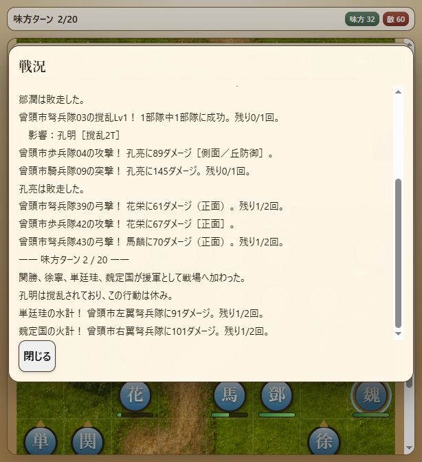

# Milestone 38 — 第九章勝利・6地点の保存再開・全9章の攻略検証

2026-10-17。版は `10.0.0-dev.38`。第九章「曾頭市・宿命の決戦」を元の編成から第14ターンの殲滅勝利まで検証し、全9章それぞれの開始から勝利までの自動検証が揃った。今回の実装は検証用経路・回帰テストの追加と共通テスト処理の整理。人物能力、兵力、初期配置、敵AI、戦闘規則、画面仕様を変えて勝てるようにしたものではない。保存形式6、内容revision `v10-v9-chapter-catalog-9` を維持。

## 第九章の勝利経路

`test-support/zengtou-victory-route.js` に、元の95部隊（味方31・敵60・予備4）、seed 1による14ターン・327操作を記録した。通常の移動・攻撃・弓撃・突撃・撹乱・幻術・火計・水計・待機をControllerへ渡す。強制配置、兵力上書き、敵の強制除去、ターン変更、イベントの直接発火は行わない。

合法な指示を保存状態から比較し、敵ターン後の生存と戦力を確認して経路を選定した。選定用の判断処理は製品に組み込まず、固定した操作列を新規開始から改めて再実行して検証した。

- 第1敵ターンに秦明が敗走し、第2味方ターンに関勝・徐寧・単廷珪・魏定国が到着する。
- 第3・4ターンに水計、第4・5ターンに火計を使用。救援隊と本隊で敵の南側を崩す。
- 第6味方ターンに郁保四が加入する。北側の部隊も戦いながら盧俊義の退路を確保する。
- 第14ターンに李逵・楊志・徐寧・項充が最後の敵・曾密を順に攻撃し、項充の攻撃で勝利する。
- 最終状態は宋江149・盧俊義41、味方11隊生存・敵0隊。加入後の総勢36人のうち25人が敗走する経路であり、全員生還や全乱数での攻略を示すものではない。
- 勝利演出の後、宋江・盧俊義・呉用の章末3台詞を一度だけ表示する。

## 保存再開と画面入力

`tests/v9-zengtou-progression.test.js` は、通常のSaveService・slot guard・resumeLoadedBattleで以下の6地点から再開し、最終状態が連続実行と完全一致することを確認する。

1. 第1味方ターンの全31操作後：秦明が生存、救援前。
2. 第2味方ターン開始：救援4人が到着した直後。
3. 第4味方ターンの16操作後：水計を2回、火計を1回使った状態。
4. 第5味方ターンの全操作後：寝返り直前。
5. 第6味方ターン開始：郁保四の寝返り直後。
6. 第14味方ターンの3操作後：曾密だけが残り、項充の最後の攻撃前。

比較は兵力・位置・向き・行動状態・使用回数・状態異常・乱数・イベント・戦況履歴を含む。発生済みの救援・寝返りや導入会話をロードで繰り返さず、勝利履歴・勝利演出・中断保存の削除通知は各1回。イベントが同じターンに続けて起きるM37の137操作の経路も残した。

`tests/battle-screen.test.js` は第九章の画面操作ヘルパーを共通化し、既存のイベント経路と今回の327操作の勝利経路を検証する。実際の盤面・コマンドのクリック処理、特殊計略の直接対象選択、向き確定、会話中の入力ロック、救援・寝返り・章末会話を通す。fake DOMの結合テストであり、実ブラウザーの14ターン完走とは区別する。

## 実ブラウザーでの火計・水計と再開

M37の第九章第2味方ターンから通常操作で継続した。この盤面は独立した実乱数の試行であり、上記seed 1の勝利経路とは別である。

- 関勝を `(1,16)` へ移して北向き待機し、単廷珪の通路を空けた。
- 単廷珪を `(0,16)` へ移し、`(0,14)` の曾頭市左翼弩兵隊に水計。91ダメージ、敵兵力210→119、残り1/2回。北向きで確定した。
- 徐寧を `(6,16)` へ移して北向き待機し、魏定国の通路を空けた。
- 魏定国を `(7,15)` へ移し、`(7,12)` の曾頭市右翼弩兵隊に火計。101ダメージ、敵兵力210→109、残り1/2回。
- 火計の効果が確定し、向きだけ未確定の状態でページを再読み込み。「続きから再開」で同じ向き指定画面に復帰し、「戻る」は無効のまま。両計略のダメージ・位置を保持した。
- 復元後に北向きを確定し、火計が再発動せず、戦況の水計・火計の履歴が各1件、残り1/2回であることを確認した。

終了時は第2味方ターン・味方32・敵60。関勝・単廷珪・徐寧・魏定国は北向きで行動済み。魏定国の情報を表示し、中断保存を保持。ブラウザー警告・エラー0件。今回のブラウザー操作はV10の確認であり、V9実画面との同時比較や勝利完走ではない。

## 検証結果と残作業

- 全324テスト成功、失敗・スキップなし（51.4秒）。
- 起動入口と新しい経路の構文確認、diff空白チェック成功。
- 全9章それぞれの元編成からの勝利を自動検証できる。第二〜九章は途中保存からの最終状態比較と画面クリックの結合テストも成功。第一章の勝利経路に同じ途中保存比較・画面クリックの自動テストはまだ揃っておらず、実ブラウザーの勝利確認とは区別する。9章を一つの連続セッションで通した検証という意味ではない。
- 第一章は実ブラウザーで勝利・次章移行を確認済み。第二〜九章の実ブラウザー完走と、細かなV9との表示・操作比較が残る。全体の完成や完全一致はまだ宣言しない。
- 能力値は固定V9を基準とする。Excel第4.7版と照合済みとは扱わない。
- 固定V9参照HEAD `3e3fb85ca8279e5351668562dea677df777a1ddc` と作業ツリーは未変更。
- 調査用スクリプト・一時経路10ファイルを削除し、検証済みの操作列とテストを残した。M14以降の作業はローカルで保持。push・公開なし。
