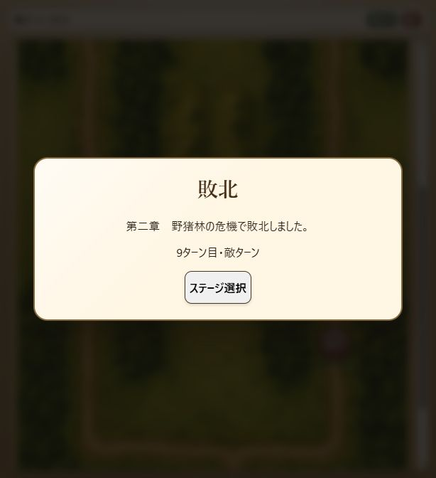
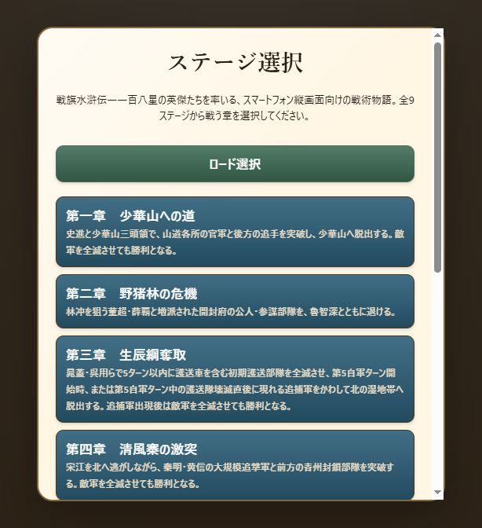

# Milestone 39 — 第一章の保存再開・画面入力を補完

2026-10-17。版は `10.0.0-dev.39`。第一章の既存の攻略経路を途中から再実行できる操作列へ整理し、保存再開と画面入力の結合テストを追加した。人物能力・兵力・初期配置・敵AI・戦闘規則・画面仕様は変更していない。保存形式6、内容revision `v10-v9-chapter-catalog-9` を維持。

## 第一章の保存再開

`test-support/opening-escape-route.js` の既存の合法な指示を、6ターン・16操作の凍結した配列にした。ターンと操作番号を指定して再開できる。最後は実画面と同じ即時移動を使い、待機・向き確定を挟まずに史進が `(3,0)` へ脱出する。

`tests/v9-battle-progression.test.js` は、新規開始と次の4地点の通常SaveServiceからの復元を比較する。

1. 第1ターン、朱武の最初の撹乱と向き確定の直後。
2. 第3ターン開始。
3. 第5ターン、史進の撹乱と向き確定の直後。
4. 第6ターン開始、最後の脱出移動の直前。

いずれも第6味方ターン、史進55・位置 `(3,0)` で勝利し、兵力・位置・向き・状態異常・行動状態・使用回数・乱数・イベント・戦況履歴を含む最終保存データが一致する。復元で導入会話・作戦条件を再表示せず、勝利履歴と勝利演出は各1回。勝利演出の後に章末会話を表示する。兵力やターンを直接変更した経路ではない。

## 第一章の画面入力

`tests/battle-screen.test.js` は実際の画面クリック処理で、導入会話・作戦条件・全16操作・章末会話を通す。移動プレビューでDomainと乱数が変わらないこと、第2ターンの史進の移動を一度取り消しても元位置を保つこと、最後の脱出先クリックで入力をロックして勝利することも確認する。

これで全9章それぞれについて、新規開始から勝利、途中保存から同じ最終状態への復元、画面クリックから章末会話までの自動検証がそろった。画面入力テストはfake DOMの結合テストであり、実ブラウザーで全9章を連続完走した意味ではない。

## 第二章の実ブラウザー進行

dev.39で通常のステージ選択から第二章を2回開始した。乱数・盤面・兵力・ターンを注入せず、画面の移動・通常攻撃・突撃・撹乱・待機・ターン終了だけを操作した。自動検証のseed 1とは独立した試行である。

- 1回目は第4味方ターン、林冲112・魯智深95、味方2・敵4でページを再読み込みし、「続きから再開」を実行した。全生存部隊の位置・兵力・向き・行動済み表示と戦闘概要のDOMが読み込み前と一致。導入・作戦条件の再表示なし。戦況に撹乱失敗と残り1/2回の履歴も残った。
- その後、魯智深は第5敵ターン、林冲は第6敵ターンに敗走した。魯智深だけの敗走では継続し、林冲の敗走で敗北となる。敗北演出を閉じると第二章・6ターン目・敵ターンの結果を表示し、「次のステージ」はなく、「ステージ選択」へ戻れた。
- 2回目は参謀を通常攻撃で倒し、突撃を温存する別の指示を試した。第7ターンに董超、第9ターンに弓兵を撃破し、薛覇1隊が残った。林冲18で第9敵ターンを迎え、薛覇の攻撃で敗北した。
- 今回の実操作でも第二章の勝利は確認できていない。自動検証の第8ターン勝利と混同しない。攻略のための人物値・敵AI・難易度変更は行わない。
- 第9敵ターンの敗北結果からステージ選択に戻り、再読み込みしてタイトルを進めると中断再開の案内なしで全9章の選択画面になった。終了済みの戦闘を再提示しないことを確認。ブラウザー警告・エラー0件。終了時はこの選択画面を保持し、進行中の中断データはない。

## 検証結果

- 全325テスト成功、失敗・スキップなし（46.0秒）。
- 起動入口・公開入口・第一章の操作列の構文確認成功。
- diffの空白チェック成功。一時テスト出力を削除。
- 固定V9参照HEAD `3e3fb85ca8279e5351668562dea677df777a1ddc` と作業ツリーは未変更。
- 能力値は固定V9基準。Excel第4.7版と照合済みとは扱わない。
- 変更はローカルに保持し、push・公開は行っていない。

## 残作業

第二〜九章の実ブラウザーでの勝利完走、細かなV9との表示・操作比較は残る。第一章は以前の実操作で勝利と次章移行まで確認済み。今回の追加は検証の不足を補ったもので、ゲーム全体の完成やV9との完全一致を宣言するものではない。
