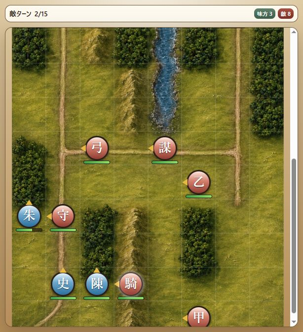
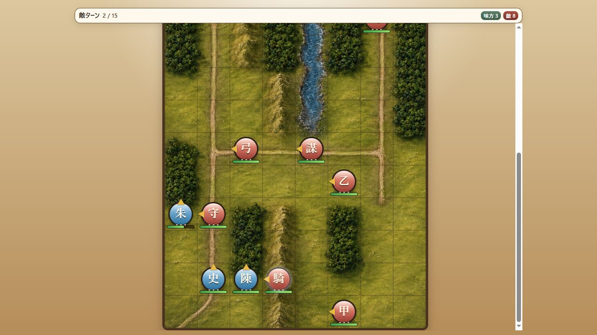

# Milestone 40 — 敵の行動表示と画面追従を復元

2026-10-18。版は `10.0.0-dev.40`。V9.7.75とのコード照合から、敵の手番を示す選択輪と画面の追従がV10で欠落していることを確認し、表示側の実装を修正した。人物能力・兵力・初期配置・AIの行動選択・戦闘計算・乱数消費は変更していない。保存形式6、内容revision `v10-v9-chapter-catalog-9` を維持。

## 原因と修正

V9の `enemyAction` は、移動の有無にかかわらず行動開始時に敵へ白い輪を移し、そのマスを画面内へ収める。撹乱で行動を休む敵にも適用する。V10の `SelectionRingView` と `BattleRenderer` は、入力がロックされている間は輪とスクロールの両方を禁止していた。

- `BattleController` が敵の行動を実行する前に、対象IDだけの意味的要求 `UNIT_FOCUS` を通知する。追加の待機時間は0。AIの計画・戦闘結果・保存データは表示に依存しない。
- `BattleScreen` が自動行動中の表示対象を操作用の選択部隊から分離して保持。MOVEでは確定した現在位置へ輪を移し、PHASE_STARTの状態異常処理と強制行動にも追従する。
- `SelectionRingView` は表示対象がある間、入力がロック中でも輪を描く。敵は白、味方の幻術行動は味方色。操作用のコマンドや部隊情報へ敵を選択した扱いにはしない。
- `BattleRenderer` は表示対象のマスが変わったときに画面内へ収める。通常の再描画では手動スクロールを引き戻さない。
- CSSは実際の演出要素が残っている間だけ輪を隠す。ACTION通知の完了後も続く突撃の砂煙、兵の点滅、火計・水計・幻術・撹乱の表示に対応する。
- ターン境界・会話・作戦条件・結果表示で対象を解除。次の味方の操作開始時にも解除する。通常の味方の移動プレビューを自動行動の対象として扱わない。

## 自動検証

修正前に、敵の移動先に輪が存在しないテスト失敗を確認した。修正後は次の3テストを追加し、既存の通常選択・仮移動・取消・行動済み表示のテストも維持した。

1. 実Controllerの敵ターンを通し、移動開始地点・移動の各マス・その場の弓撃・撹乱休みの輪を検証。処理中に部隊・待機・ターン終了をクリックしても状態と乱数は変わらず、次の味方ターンに輪が解除されて操作できる。
2. 味方の幻術による強制移動・同士討ちを通し、輪と入力ロックを確認。強制行動後は通常の味方選択に戻る。
3. 小さい表示領域で遠いマスを画面内へ収めること、同じマスの再描画ではスクロールを戻さないこと、自動行動の対象が解除された後はロック中の通常選択へ追従しないことを検証。

これらは小規模fixtureによる境界・画面結合テストであり、章の攻略経路とは区別する。全9章の元編成からの勝利・途中保存からの最終状態比較・画面クリック結合テストも成功した。

- 全328テスト成功、失敗・スキップなし（51.8秒）。
- 変更したJavaScriptの構文検査、diffの空白検査に成功。
- V9参照HEAD `3e3fb85ca8279e5351668562dea677df777a1ddc` と参照ファイルは未変更。
- 能力値は固定V9基準。Excel第4.7版との照合済みとは扱わない。

## 実ブラウザー比較

V9とV10で第一章を通常起動し、全隊をその場で北向きに待機させ、第1・第2敵ターンを観察した。兵力・乱数・位置・ターンの注入は行っていない。敵の行動を見るための待機操作で、攻略・勝利検証ではない。

- 両版で官軍騎兵隊長への輪の移動、歩行中の輪の追従、第2ターンに `(3,14)` から行うその場攻撃を確認。
- V10で攻撃前の輪が `visible`、ダメージ演出中に `hidden`、次の敵の移動中に再び `visible` になることをDOMと描画で確認。V9でも攻撃演出中は輪が消える。
- V10の第2敵ターンではスクロール位置が478→495→401→194と変わり、下側の騎兵・官兵から上側の弓兵・関所守備兵へ追従した。第3味方ターンでは輪が解除され、通常の操作ボタンが戻った。
- 各試行の乱数は独立している。両版で楊春が第1敵ターンに敗走したが、ダメージ値の完全一致を主張する比較ではない。
- 最新版を再読み込みして「続きから再開」を実行し、第3味方ターンの全生存部隊の位置・兵力・向きと戦闘概要が読み込み前と完全一致。導入・作戦条件の再表示なし。終了時は史進130 `(1,14)`、朱武30 `(0,12)`、陳達34 `(2,14)`、味方3・敵8、選択なし。中断保存あり、ブラウザー警告・エラー0件。4174のNodeサーバーを再起動済み（PID18380）。

## 残作業

第二〜九章の実ブラウザーでの勝利完走、細かなV9との表示・操作比較を継続する。第一章は以前の実操作で勝利と次章移行まで確認済み。全体の完成やV9との完全一致は未確認。変更はローカルに保持し、push・公開は行っていない。
